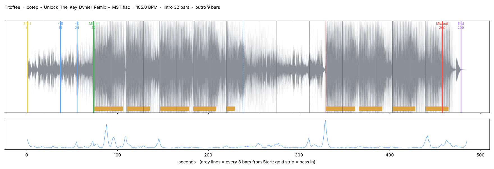
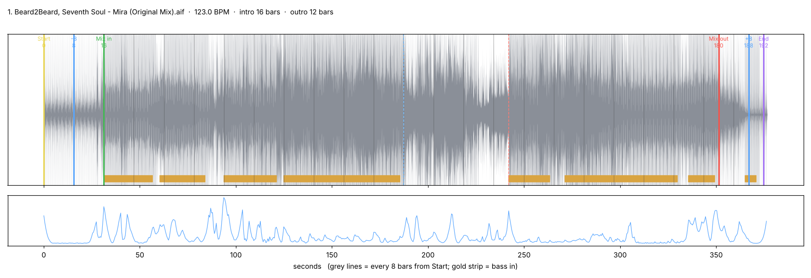
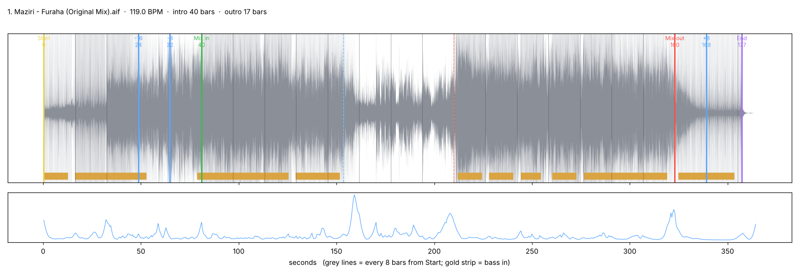

> **Prototype, not approved, not part of the app.** Written 2026-10-13 to test phrase-snapped mix in/out cues. No ground truth yet: the plan (proposed, not confirmed) is to score it against Traktor cues inside #137 and #156. `cues.py` needs librosa/matplotlib and is deliberately outside the test suite and CI. Index: [../../README.md](../../README.md).

# Cue-prototype: mixpunkter på 5 numre fra Downloads

Kørt 2026-10-13 af `cues.py` (librosa, ingen ML). Alle tider er fra filens start. Takter er talt fra Start. Lyt efter i Traktor: sidder Mix ind og Mix ud der, hvor *du* ville mixe?

## 1. Titoffee_Hibotep_-_Unlock_The_Key_Dvniel_Remix_-_MST

105.0 BPM · intro 32 takter · outro 9 takter

| Cue | Takt | Tid |
|---|---|---|
| Start | 0 | 0:00.570 |
| -16 | 16 | 0:37.142 |
| -8 | 24 | 0:55.428 |
| Mix in | 32 | 1:13.714 |
| Mix out | 200 | 7:37.719 |
| End | 209 | 7:58.291 |

Struktur: Breakdown takt 104 (3:58.287), Drop takt 144 (5:29.717)

## 2. 1. Beard2Beard, Seventh Soul - Mira (Original Mix)

123.0 BPM · intro 16 takter · outro 12 takter

| Cue | Takt | Tid |
|---|---|---|
| Start | 0 | 0:00.040 |
| -8 | 8 | 0:15.650 |
| Mix in | 16 | 0:31.261 |
| Mix out | 180 | 5:51.272 |
| +8 | 188 | 6:06.883 |
| End | 192 | 6:14.688 |

Struktur: Breakdown takt 96 (3:07.364), Drop takt 124 (4:02.000)

## 3. 01. Genii - I Cant Go Back To Yesterday (Original Mix) [ INSIDE ]

121.0 BPM · intro 16 takter · outro 8 takter

| Cue | Takt | Tid |
|---|---|---|
| Start | 0 | 0:00.290 |
| -8 | 8 | 0:16.158 |
| Mix in | 16 | 0:32.027 |
| Mix out | 116 | 3:50.381 |
| End | 124 | 4:06.250 |

Struktur: Breakdown takt 72 (2:23.105), Drop takt 80 (2:38.974)

![01. Genii - I Cant Go Back To Yesterday (Original Mix) [ INSIDE ].aif](3.png)

## 4. 1. Maziri - Furaha (Original Mix)

119.0 BPM · intro 40 takter · outro 17 takter

| Cue | Takt | Tid |
|---|---|---|
| Start | 0 | 0:00.340 |
| -16 | 24 | 0:48.743 |
| -8 | 32 | 1:04.878 |
| Mix in | 40 | 1:21.012 |
| Mix out | 160 | 5:23.028 |
| +8 | 168 | 5:39.163 |
| End | 177 | 5:57.314 |

Struktur: Breakdown takt 76 (2:33.617), Drop takt 104 (3:30.088)

## 5. Stephan Zovsky - Shut Up (Original Mix)  [Sueslide Records]

130.0 BPM · intro 32 takter · outro 24 takter

| Cue | Takt | Tid |
|---|---|---|
| Start | 0 | 0:00.290 |
| -16 | 16 | 0:29.828 |
| -8 | 24 | 0:44.597 |
| Mix in | 32 | 0:59.365 |
| Mix out | 184 | 5:39.974 |
| +8 | 192 | 5:54.743 |
| +16 | 200 | 6:09.512 |
| End | 208 | 6:24.280 |

Struktur: Breakdown takt 64 (1:58.441), Drop takt 80 (2:27.979), Breakdown 2 takt 124 (3:49.207), Drop 2 takt 144 (4:26.130)

![Stephan Zovsky - Shut Up (Original Mix)  [Sueslide Records].aif](5.png)
